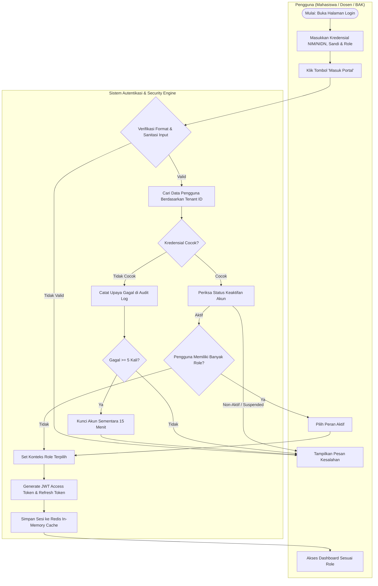
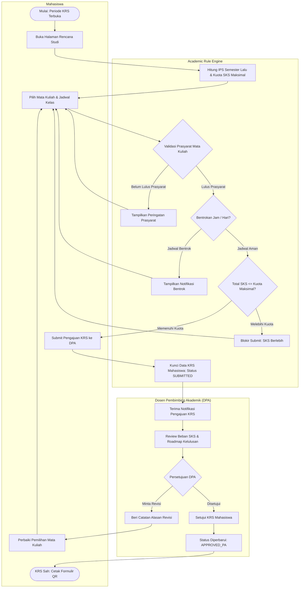
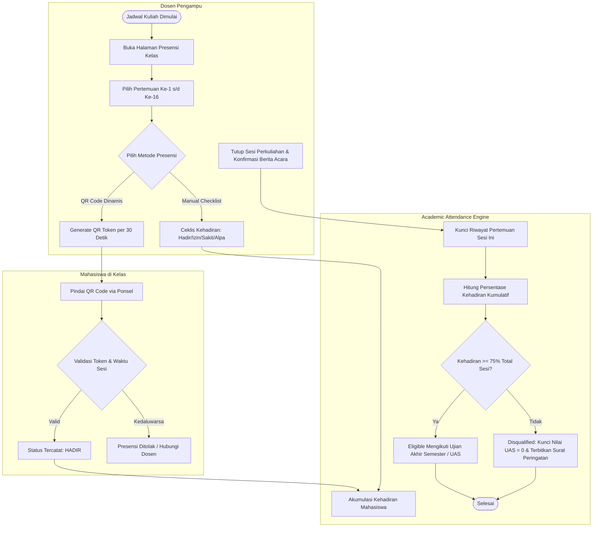
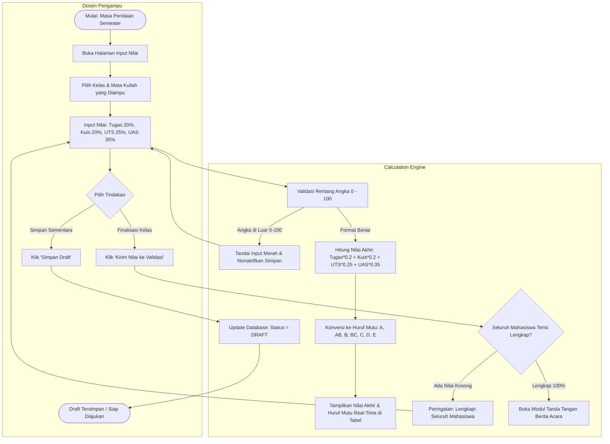
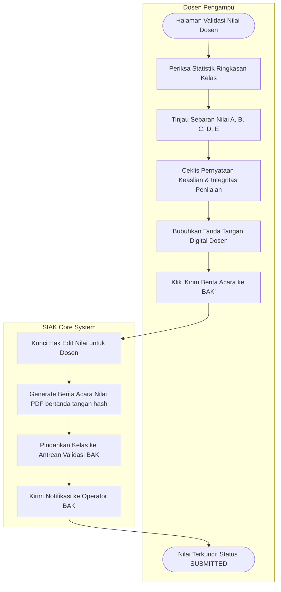
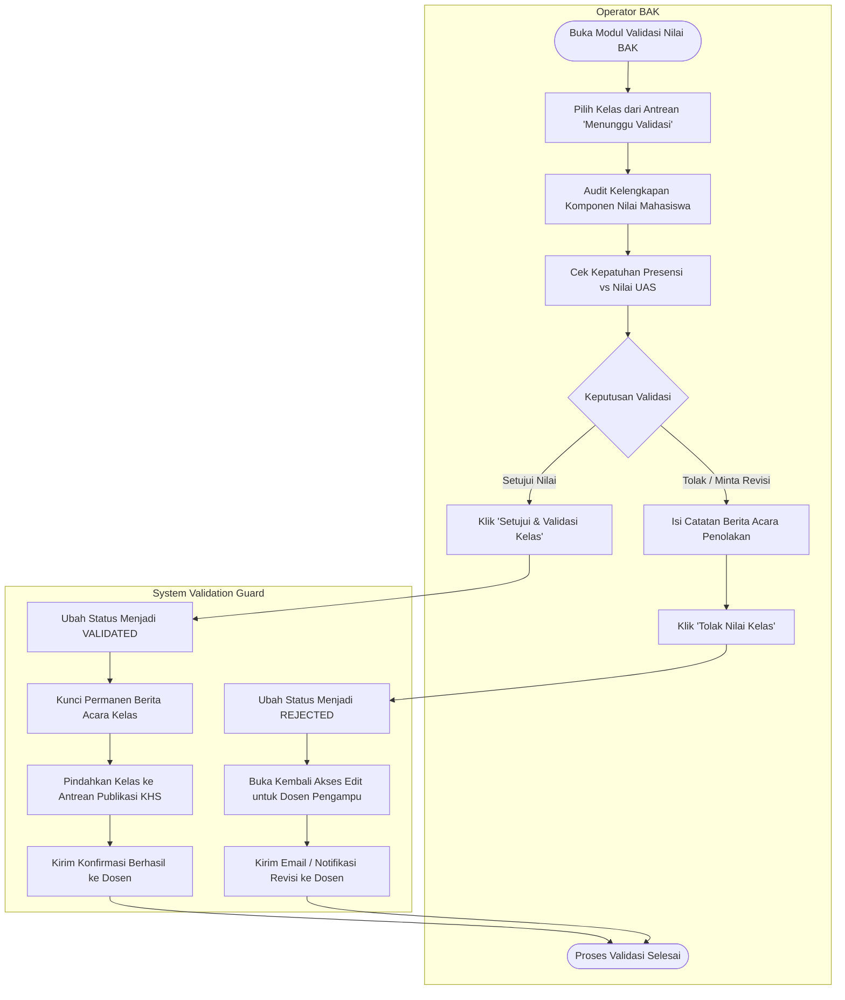
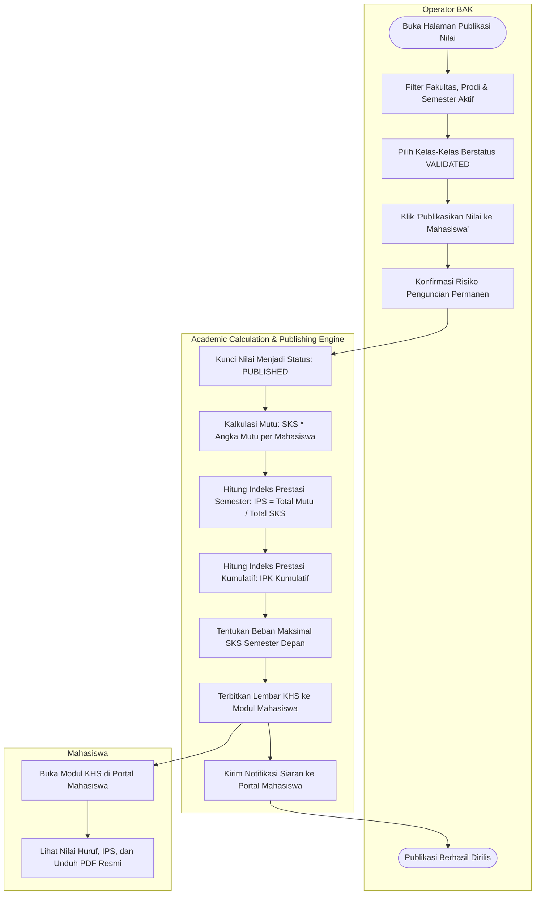
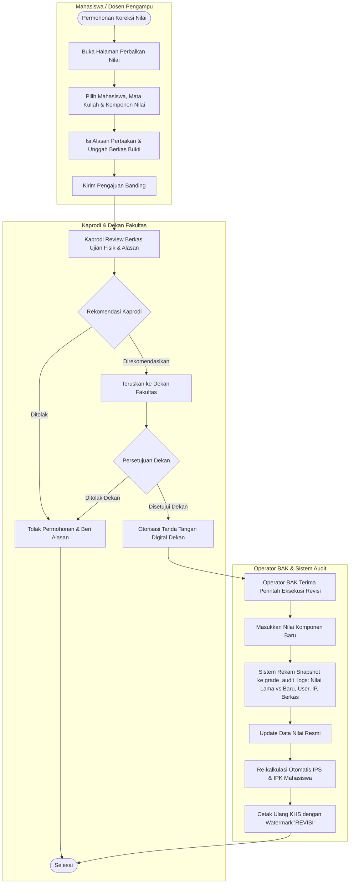
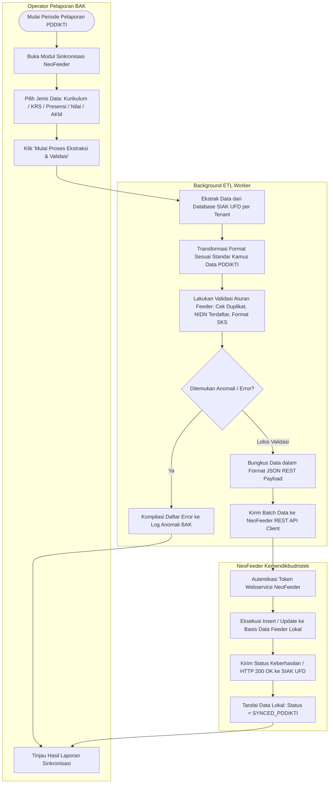

# SIAK UFD Enterprise SaaS - Activity Diagrams per Activity
**Kumpulan Diagram Aktivitas Terperinci (UML Activity Diagrams)**  
*Universitas Fatmawati Digital (SIAK UFD) — Multi-Tenant Academic ERP SaaS*

---

## 1. Ikhtisar Diagram Aktivitas (Activity Diagrams Overview)

Dokumen ini memetakan seluruh aktivitas operasional utama di dalam platform **SIAK UFD Enterprise SaaS** menggunakan standar **UML Activity Diagram** dengan pemisahan peran (*Swimlane / Partition*) yang jelas antara:
- **Mahasiswa**
- **Dosen (Pengampu & PA)**
- **Operator BAK**
- **Pimpinan (Kaprodi & Dekan)**
- **Sistem Inti (Academic Engine, Database & Gateway)**

---

## 2. Activity 1: Autentikasi Pengguna & Resolusi Multi-Tenant

Memodelkan proses login terpadu, verifikasi keamanan bertingkat, penentuan tenant universitas, dan navigasi peran dinamis.



---

## 3. Activity 2: Pengisian & Validasi Kartu Rencana Studi (KRS)

Memodelkan pemilihan kelas mata kuliah oleh mahasiswa, pengecekan prasyarat & beban SKS secara otomatis, hingga persetujuan Dosen PA.



---

## 4. Activity 3: Pelaksanaan Perkuliahan & Presensi 16 Pertemuan

Memodelkan pembukaan ruang kelas oleh dosen, presensi mandiri (QR dinamis) / manual, dan kalkulasi gerbang kelayakan UAS (kehadiran $\ge 75\%$).



---

## 5. Activity 4: Penilaian Multi-Komponen oleh Dosen Pengampu

Memodelkan kalkulasi bobot angka numerik, penentuan huruf mutu otomatis, dan penyimpanan draft nilai kelas.



---

## 6. Activity 5: Pengajuan Nilai Kelas ke Validasi BAK

Memodelkan proses penguncian nilai oleh dosen, penerbitan berita acara nilai kelas, dan pengalihan hak edit ke antrean BAK.



---

## 7. Activity 6: Verifikasi & Validasi Nilai oleh Operator BAK

Memodelkan audit kepatuhan akademik, analisis sebaran nilai, serta keputusan persetujuan (*approval*) atau penolakan (*rejection*) oleh Operator BAK.



---

## 8. Activity 7: Publikasi Massal Nilai Semester ke KHS Mahasiswa

Memodelkan rilis nilai secara serentak per program studi/fakultas, re-kalkulasi Indeks Prestasi Semester (IPS), dan pembaruan KHS mahasiswa.



---

## 9. Activity 8: Permohonan & Audit Trail Perbaikan Nilai Pasca Publikasi

Memodelkan alur banding revisi nilai resmi yang diawasi secara hierarkis oleh Kaprodi dan Dekan Fakultas guna mencegah kecurangan akademik.



---

## 10. Activity 9: Penerbitan Dokumen Resmi (KHS & Transkrip) dengan QR Verifier

Memodelkan penyusunan dokumen akademik legal, kalkulasi aturan pengulangan nilai terbaik (*Best Grade Policy*), dan penyematan QR code verifikasi publik.

```mermaid
flowchart TD
    subgraph User_Lane ["Mahasiswa / Operator BAK"]
        D1([Akses Halaman Transkrip / KHS]) --> D2[Pilih Format Dokumen: KHS Semester / Transkrip Lengkap]
        D2 --> D3[Klik 'Unduh Dokumen PDF Resmi']
        D7[Unduh Berkas PDF atau Cetak via Printer]
    end

    subgraph Engine_Lane ["Document Generation & Security Engine"]
        D3 --> G1[Query Riwayat Nilai Seluruh Semester]
        G1 --> G2{Terdapat Mata Kuliah Diulang?}
        G2 -->|Ya| G3[Terapkan Kebijakan: Ambil Nilai Mutu Terbaik]
        G2 -->|Tidak| G4[Ambil Seluruh Mata Kuliah Lulus]
        G3 --> G5[Kompilasi SKS Lulus & Hitung IPK Akhir]
        G4 --> G5
        G5 --> G6[Tentukan Predikat Yudisium: Cum Laude / Sangat Memuaskan / Memuaskan]
        G6 --> G7[Generate Cryptographic Hash SHA-256 dari Isi Transkrip]
        G7 --> G8[Generate Dynamic QR Code: https://verify.ufd.ac.id/doc/{hash}]
        G8 --> G9[Render Dokumen PDF Sesuai Standar Kop Surat Universitas]
        G9 --> D7
    end

    subgraph ThirdParty_Lane ["Pihak Ketiga (Perusahaan / Kementerian)"]
        D7 -.-> T1[Pindai QR Code Menggunakan Kamera Ponsel]
        T1 --> T2[Buka Halaman Verifikasi Publik Tanpa Login]
        T2 --> T3[Sistem Verifikasi: Validasi Kesesuaian Data Asli vs Berkas Fisik]
    end
```

---

## 11. Activity 10: Sinkronisasi Terjadwal PDDIKTI NeoFeeder

Memodelkan ekstraksi data dari basis data lokal SIAK UFD, transformasi ke skema Forlap Dikti, validasi anomali, hingga pengiriman data ke server nasional.



---
*Dokumen ini merupakan panduan alur aktivitas resmi SIAK UFD Enterprise SaaS. Seluruh diagram dapat dirender secara langsung menggunakan engine Mermaid.*
