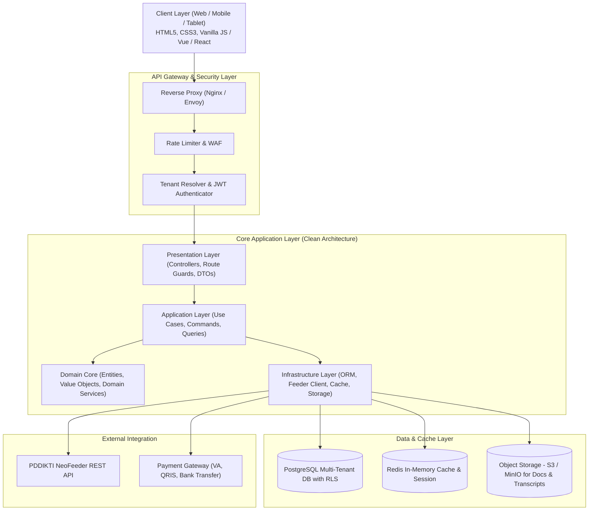
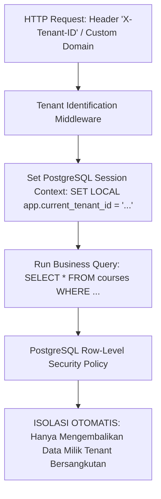
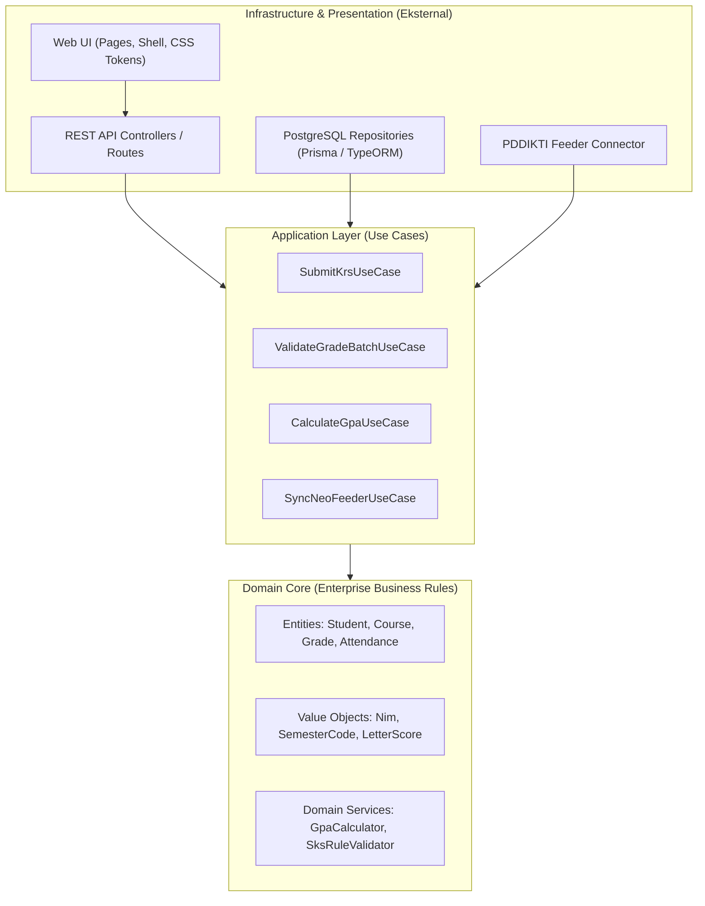
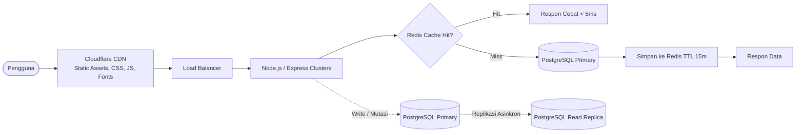

# SIAK UFD Enterprise SaaS - System Architecture & Clean Code Blueprint
**Panduan Arsitektur Sistem, Desain Perangkat Lunak & Standar Clean Code**  
*Universitas Fatmawati Digital (SIAK UFD) — Multi-Tenant Academic ERP SaaS*

---

## 1. Ikhtisar Arsitektur (Architectural Overview)

SIAK UFD dibangun sebagai platform **Multi-Tenant Academic Software-as-a-Service (SaaS)** yang dapat melayani ratusan institusi pendidikan tinggi (universitas, institut, politeknik, sekolah tinggi) dalam satu infrastruktur komputasi awan yang terdistribusi, aman, dan berkinerja tinggi.

Arsitektur sistem mengadopsi prinsip **Clean Architecture (Robert C. Martin)** dipadukan dengan **Domain-Driven Design (DDD)** untuk memisahkan logika bisnis akademik dari detail teknis (framework, basis data, dan UI).



---

## 2. Model Multi-Tenansi (Multi-Tenancy Strategy)

SIAK UFD menerapkan pola **Pooled Database with Row-Level Security (RLS)** untuk efisiensi biaya, kemudahan maintenance, dan skalabilitas horizontal.



### 2.1 Enkapsulasi Row-Level Security (PostgreSQL)
```sql
-- Mengaktifkan RLS pada tabel sensitif
ALTER TABLE students ENABLE ROW LEVEL SECURITY;

-- Kebijakan isolasi data tenant
CREATE POLICY tenant_student_isolation_policy ON students
    FOR ALL
    USING (tenant_id = NULLIF(current_setting('app.current_tenant_id', true), '')::UUID);
```

### 2.2 Penanganan Custom Domain & Subdomain
Setiap institusi penyewa mendapatkan subdomain bawaan atau domain kustom:
- Default Subdomain: `https://ufd.siak.cloud`
- Custom Vanity Domain: `https://siak.fatmawati.ac.id` (didukung otomatis via CNAME dan TLS Let's Encrypt Otomatis).

---

## 3. Implementasi Clean Architecture 4-Lapis

Pemisahan tanggung jawab (*Separation of Concerns*) dibagi menjadi 4 lingkaran independen:



### 3.1 Domain Layer (Lingkaran Inti)
- Tidak memiliki ketergantungan pada pustaka pihak ketiga manapun.
- Berisi entitas murni, value objects, dan aturan logika absolut (misalnya: formula perhitungan IPS/IPK, aturan minimal presensi 75%).
- Contoh Value Object Nilai Mutu:
  ```typescript
  export class LetterScore {
    private readonly validScores = ['A', 'AB', 'B', 'BC', 'C', 'D', 'E'] as const;
    
    constructor(private readonly score: string) {
      if (!this.validScores.includes(score as any)) {
        throw new InvalidLetterScoreException(`Nilai mutu ${score} tidak valid.`);
      }
    }
    
    get weight(): number {
      const weights: Record<string, number> = {
        'A': 4.0, 'AB': 3.5, 'B': 3.0, 'BC': 2.5, 'C': 2.0, 'D': 1.0, 'E': 0.0
      };
      return weights[this.score];
    }
  }
  ```

### 3.2 Application Layer (Use Cases)
- Mengorkestrasi aliran data ke dan dari entitas domain.
- Menangani transaksi bisnis, pemanggilan repository interface, dan penerbitan event notifikasi.
- Menerapkan pola **CQRS (Command Query Responsibility Segregation)**:
  - *Commands*: Mengubah state data (misal: `PublishGradesCommand`, `SubmitAttendanceCommand`).
  - *Queries*: Membaca data berkinerja tinggi (misal: `GetStudentTranscriptQuery`).

### 3.3 Infrastructure Layer
- Implementasi konkret dari interface yang didefinisikan oleh application layer.
- Koneksi basis data, eksekusi query PostgreSQL, caching Redis, pengiriman email SMTP/WhatsApp gateway, dan komunikasi HTTP ke PDDIKTI NeoFeeder.

### 3.4 Presentation Layer
- Bertanggung jawab menerjemahkan permintaan klien menjadi DTO yang dimengerti oleh Use Cases.
- Menghasilkan respon HTTP terstruktur dengan format standar RFC.

---

## 4. Standar RESTful API Conventions

### 4.1 Struktur URL Standar
Semua endpoint API mematuhi konvensi RESTful dengan scoping tenant eksplisit:
```
/api/v1/tenants/{tenant_id}/academic-years/{year_id}/classes/{class_id}/grades
```

### 4.2 Standard API Response Envelope
Seluruh endpoint API mengembalikan struktur JSON konsisten:
```json
{
  "success": true,
  "code": 200,
  "message": "Nilai kelas berhasil divalidasi oleh Operator BAK",
  "data": {
    "class_id": "cls-ti-3a-algo",
    "course_name": "Algoritma & Pemrograman",
    "total_students": 38,
    "status": "VALIDATED",
    "validated_at": "2026-11-18T08:30:00Z"
  },
  "meta": {
    "tenant_id": "ten-ufd-prod",
    "request_id": "req-9b872c1a",
    "timestamp": "2026-11-18T08:30:01Z"
  }
}
```

### 4.3 Error Response Standard (RFC 7807)
```json
{
  "success": false,
  "code": 422,
  "error_type": "VALIDATION_FAILED",
  "title": "Unprocessable Entity",
  "detail": "Terdapat 2 mahasiswa yang belum memiliki nilai tugas",
  "invalid_params": [
    { "name": "scores[4].tugas", "reason": "Nilai tugas tidak boleh kosong" },
    { "name": "scores[12].tugas", "reason": "Nilai tugas harus berupa angka antara 0-100" }
  ]
}
```

---

## 5. Standar Frontend: Zero Layout Shift & Clean UI Architecture

Seluruh 28 halaman sistem dibangun dengan prinsip **Deterministic Layout Sizing** untuk menjamin **0 Cumulative Layout Shift (CLS)** dan **0 Horizontal Scrolling**:

### 5.1 CSS Hierarchy & Global Shell Contracts
Setiap halaman wajib mengadopsi hierarki DOM berikut:
```html
<div class="siak-app-canvas">
  <aside class="siak-sidebar">
    <!-- 224px Fixed Width Sidebar -->
  </aside>
  <div class="siak-main-layout">
    <header class="siak-topbar">
      <!-- 72px Fixed Height Topbar -->
    </header>
    <main class="siak-workspace-scroll">
      <div class="siak-content-container">
        <!-- 1136px Centered Inner Workspace Container -->
      </div>
    </main>
  </div>
</div>
```

### 5.2 Aturan Baku Layout Tokens (FigCraft Compliant)
1. **Sidebar Dimensi**: `width: 224px !important; min-width: 224px !important; flex-shrink: 0;`
2. **Topbar Dimensi**: `height: 72px !important; min-height: 72px !important; flex-shrink: 0;`
3. **Workspace Canvas**: `width: 100%; max-width: 1136px; margin: 0 auto; padding: 24px 32px 48px;`
4. **Zero Horizontal Scroll**: 
   ```css
   html, body {
     overflow-x: hidden !important;
     width: 100% !important;
     max-width: 100vw !important;
   }
   ```
5. **Warna Tema Utama**:
   - Primary Emerald: `#237757`
   - Primary Hover: `#1B5E43`
   - Primary Surface / Tint: `#EBF5F0`
   - Dark Text: `#1F2937`
   - Muted Text: `#64748B`
   - Border Color: `#E2E8F0`
   - Canvas Background: `#F8FAFC`
6. **Ikonografi & Aset**:
   - SVG Feather/Heroicons murni (0 dependencies, 0 emoji).
   - Tipografi: `'Inter', -apple-system, BlinkMacSystemFont, 'Segoe UI', Roboto, sans-serif`.

---

## 6. Keamanan & Kepatuhan Enterprise (Security & Compliance)

### 6.1 Autentikasi & Otorisasi
- **JWT dengan Token Rotatif**: Access Token (masa aktif 15 menit) + Refresh Token (masa aktif 7 hari yang disimpan dalam `HttpOnly, Secure, SameSite=Strict` Cookie).
- **Role-Based Access Control (RBAC)**: Enkapsulasi hak akses secara ketat pada 4 role utama: `Mahasiswa`, `Dosen`, `Operator BAK`, dan `Super Admin Tenant`.
- **Attribute-Based Access Control (ABAC)**: Memastikan Dosen hanya dapat menginput nilai untuk kelas mata kuliah yang ditugaskan kepadanya di semester berjalan.

### 6.2 Perlindungan Terhadap Serangan Umum (OWASP Top 10)
- **SQL Injection**: Seluruh query menggunakan parameterized prepared statements via ORM/Query Builder.
- **Cross-Site Scripting (XSS)**: Sanitasi input HTML dan penggunaan Content Security Policy (CSP).
- **Cross-Site Request Forgery (CSRF)**: Header `X-CSRF-Token` pada setiap mutasi data (POST, PUT, DELETE, PATCH).

### 6.3 Audit Trail Immutability
Seluruh aksi kritis (penghapusan kelas, perubahan nilai pasca publikasi, perubahan master kurikulum) dicatat pada tabel audit terpisah yang bersifat *Append-Only* (`INSERT` only, `UPDATE` & `DELETE` dinonaktifkan via database trigger).

---

## 7. Skalabilitas & Strategi Caching



- **Query Caching**: Data referensi yang jarang berubah (daftar program studi, katalog kurikulum, fakultas) di-cache di Redis dengan TTL 24 jam dan invalidasi otomatis saat ada mutasi data.
- **Session Caching**: Session token disimpan di Redis cluster untuk mendukung *stateless API containers* yang dapat di-*scale-out* kapanpun diperlukan.

---
*Dokumen ini merupakan arsitektur rujukan teknis resmi SIAK UFD Enterprise SaaS. Setiap penambahan modul baru wajib mematuhi standar lapis bersih dan konvensi desain yang tercantum di sini.*
