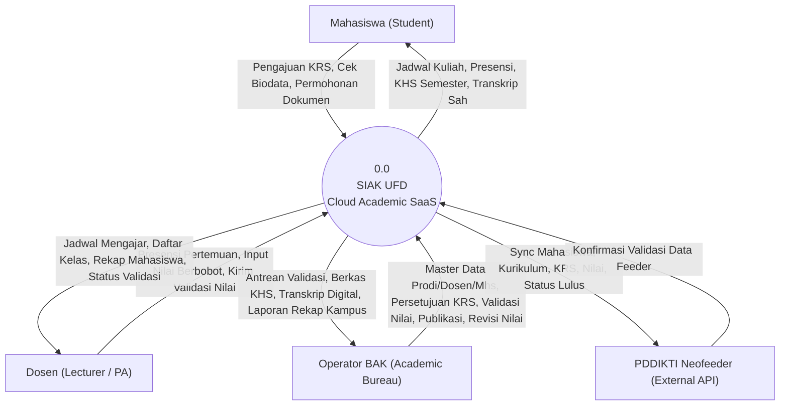
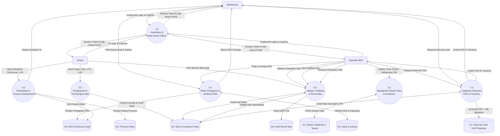
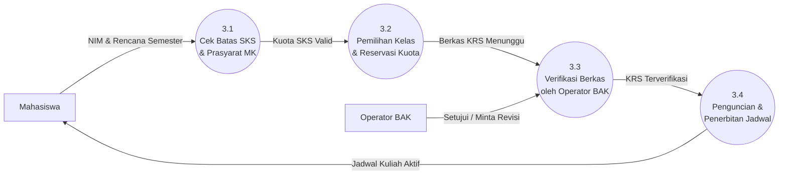
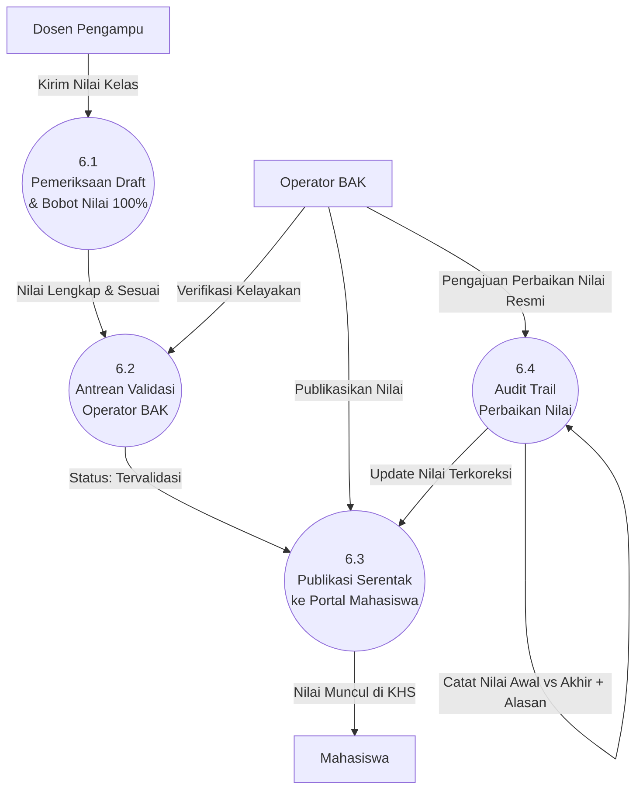

# Data Flow Diagram (DFD)
# SIAK UFD — Cloud Academic ERP & Higher Education SaaS Platform

* **Document Version:** 2.0.0
* **Scope:** Aliran Data Antarmuka & Proses Bisnis Akademik Terpadu
* **Status:** Standardized Architecture

---

## 1. DFD Level 0 — Context Diagram (Diagram Konteks)

Diagram Konteks menggambarkan batasan sistem SIAK UFD, entitas eksternal (*External Entities*), serta aliran data masuk dan keluar secara global:

---

## 2. DFD Level 1 — Dekomposisi Proses Fungsional

DFD Level 1 memecah sistem SIAK UFD ke dalam 7 subsistem utama yang saling berinteraksi melalui *Data Store*:

---

## 3. DFD Level 2 — Rincian Proses Kritis

### 3.1 DFD Level 2.3: Proses Siklus FRS / KRS Mahasiswa

### 3.2 DFD Level 2.6: Proses Validasi, Publikasi, & Perbaikan Nilai

---

## 4. Aliran Data Masuk & Keluar (I/O Specification)

| Aliran Data (*Data Flow*) | Asal (*Source*) | Tujuan (*Destination*) | Deskripsi Data yang Dibawa |
|---|---|---|---|
| `df_krs_submission` | Mahasiswa | Database (`krs_submissions`) | NIM, Kode MK, ID Kelas, Semester, Total SKS, Timestamp pengajuan. |
| `df_attendance_record` | Dosen | Database (`attendances`) | ID Kelas, Nomor Pertemuan (1–16), NIM Mahasiswa, Status Kehadiran (Hadir/Izin/Sakit/Alpa), Catatan. |
| `df_grade_entry` | Dosen | Database (`grades`) | ID Kelas, NIM Mahasiswa, Nilai Tugas (20%), Kuis (20%), UTS (25%), UAS (35%), Nilai Akhir Angka, Nilai Huruf Mutu. |
| `df_validation_approval`| Operator BAK | Database (`grade_validations`) | ID Kelas, NIDN Dosen, Timestamp Validasi, Catatan Verifikasi Kelayakan. |
| `df_grade_publication` | Operator BAK | Database (`grade_publications`)| ID Kelas, Periode Akademik, Status Terpublikasi, Tanggal Rilis. |
| `df_grade_revision_log`| Operator BAK | Database (`grade_revisions`) | NIM, Mata Kuliah, Nilai Awal, Nilai Usulan, Alasan Perubahan, ID Validator BAK. |
| `df_digital_document` | Database | Mahasiswa / BAK | Lembar PDF KHS/Transkrip, Nomor Legalisasi Resmi (TR-2026), QR-Code Hash Verifikasi. |
