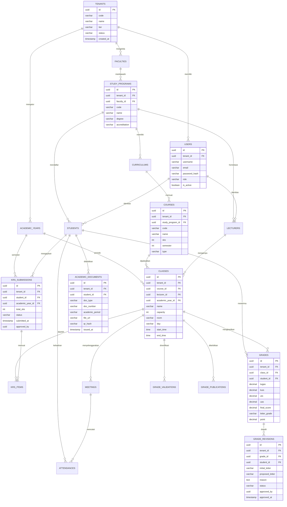

# Entity Relationship Diagram (ERD)
# SIAK UFD — Multi-Tenant Cloud Academic Database Architecture

* **Database Engine:** PostgreSQL 16+ / MySQL 8.0+
* **Data Model:** Relational Database with Row-Level Multi-Tenancy (`tenant_id`)
* **Naming Convention:** `snake_case` (Tables: Plural, Columns: Singular)
* **Status:** Production SaaS Ready

---

## 1. Visual Entity Relationship Diagram (Mermaid ERD)



---

## 2. Struktur Kamus Data & Relasi Entitas (Data Dictionary)

### 2.1 Multi-Tenant Core
Setiap tabel pada sistem SIAK UFD memiliki atribut `tenant_id` bertipe `UUID` yang merujuk pada entitas kampus penyewa layanan (*multi-tenant shared database architecture*).

```sql
CREATE TABLE tenants (
    id UUID PRIMARY KEY DEFAULT gen_random_uuid(),
    code VARCHAR(30) UNIQUE NOT NULL,      -- Contoh: 'UFD-JKT'
    name VARCHAR(255) NOT NULL,            -- Contoh: 'Universitas Fatmawati Digital'
    tier VARCHAR(50) DEFAULT 'ENTERPRISE', -- 'STARTER', 'GROWTH', 'ENTERPRISE'
    domain VARCHAR(150) UNIQUE,            -- Contoh: 'ufd.siakadcloud.id'
    status VARCHAR(30) DEFAULT 'ACTIVE',   -- 'ACTIVE', 'SUSPENDED', 'TRIAL'
    created_at TIMESTAMP WITH TIME ZONE DEFAULT CURRENT_TIMESTAMP
);
```

### 2.2 Master Akademik & Kurikulum
* **`faculties`**: Menyimpan fakultas (Teknologi Informasi, Ekonomi Bisnis, Teknik).
* **`study_programs`**: Menyimpan prodi (Teknik Informatika S1, Sistem Informasi S1, Manajemen S1, Akuntansi S1) beserta peringkat akreditasi (*Unggul, Baik Sekali*).
* **`academic_years`**: Mengelola tahun ajaran dan semester aktif (*Ganjil 2025/2026*, *Genap 2024/2025*).
* **`courses`**: Daftar mata kuliah (TI2301 Basis Data, TI2302 Jaringan Komputer, dll.) dengan bobot SKS dan kategori wajib/pilihan.

```sql
CREATE TABLE courses (
    id UUID PRIMARY KEY DEFAULT gen_random_uuid(),
    tenant_id UUID NOT NULL REFERENCES tenants(id) ON DELETE CASCADE,
    study_program_id UUID NOT NULL REFERENCES study_programs(id),
    code VARCHAR(20) NOT NULL,             -- Contoh: 'TI2301'
    name VARCHAR(150) NOT NULL,            -- Contoh: 'Basis Data'
    sks INTEGER NOT NULL CHECK (sks BETWEEN 1 AND 6),
    semester INTEGER NOT NULL CHECK (semester BETWEEN 1 AND 8),
    type VARCHAR(20) DEFAULT 'WAJIB',      -- 'WAJIB', 'PILIHAN'
    created_at TIMESTAMP WITH TIME ZONE DEFAULT CURRENT_TIMESTAMP,
    CONSTRAINT uq_course_tenant UNIQUE (tenant_id, code)
);
```

### 2.3 Manajemen Perkuliahan & Penjadwalan
* **`classes`**: Kelas yang dibuka per semester (contoh: Basis Data kelas `TI-3A`, Lab Komputer 02, Senin 08.00–09.40 WIB).
* **`meetings`**: 16 Pertemuan kelas per semester (Pertemuan 1 s.d. 16, Tanggal, Jam, Pokok Bahasan).
* **`attendances`**: Presensi mahasiswa per pertemuan (`HADIR`, `IZIN`, `SAKIT`, `ALPA`) dengan persentase kehadiran kumulatif.

### 2.4 FRS / KRS Lifecycle
* **`krs_submissions`**: Rekap pengajuan KRS mahasiswa. Status: `DRAFT`, `MENUNGGU` (86 pengajuan), `DISETUJUI` (232 pengajuan), `REVISI` (6 pengajuan).
* **`krs_items`**: Pasangan item kelas yang diambil mahasiswa dalam satu paket rencana studi.

```sql
CREATE TABLE krs_submissions (
    id UUID PRIMARY KEY DEFAULT gen_random_uuid(),
    tenant_id UUID NOT NULL REFERENCES tenants(id) ON DELETE CASCADE,
    student_id UUID NOT NULL REFERENCES students(id),
    academic_year_id UUID NOT NULL REFERENCES academic_years(id),
    total_sks INTEGER NOT NULL CHECK (total_sks <= 24),
    status VARCHAR(30) DEFAULT 'MENUNGGU', -- 'DRAFT', 'MENUNGGU', 'DISETUJUI', 'REVISI'
    submitted_at TIMESTAMP WITH TIME ZONE DEFAULT CURRENT_TIMESTAMP,
    approved_by UUID REFERENCES users(id),
    approved_at TIMESTAMP WITH TIME ZONE
);
```

### 2.5 Penilaian, Validasi, & Audit Trail Revisi Nilai
* **`grades`**: Lembar nilai per mahasiswa. Memuat komponen nilai mentah (`tugas`, `kuis`, `uts`, `uas`), nilai kumulatif terbobot `final_score`, serta huruf mutu `letter_grade` (A, A−, B+, B, C+, C, D, E) dan angka bobot `point` (4.00, 3.75, 3.50, dst.).
* **`grade_validations`**: Antrean validasi nilai kelas dosen ke Operator BAK (`MENUNGGU`, `TERVALIDASI`, `PERLU_PERBAIKAN`).
* **`grade_publications`**: Riwayat rilis nilai akhir serentak ke portal mahasiswa.
* **`grade_revisions`**: Audit trail perbaikan nilai pasca-publikasi:

```sql
CREATE TABLE grade_revisions (
    id UUID PRIMARY KEY DEFAULT gen_random_uuid(),
    tenant_id UUID NOT NULL REFERENCES tenants(id) ON DELETE CASCADE,
    grade_id UUID NOT NULL REFERENCES grades(id),
    student_id UUID NOT NULL REFERENCES students(id),
    initial_letter VARCHAR(5) NOT NULL,   -- Nilai awal (misal: 'B')
    proposed_letter VARCHAR(5) NOT NULL,  -- Nilai usulan (misal: 'A')
    reason TEXT NOT NULL,                 -- Alasan perbaikan resmi
    status VARCHAR(30) DEFAULT 'MENUNGGU',-- 'MENUNGGU', 'DISETUJUI', 'DITOLAK'
    requested_by UUID NOT NULL REFERENCES users(id),
    approved_by UUID REFERENCES users(id),
    approved_at TIMESTAMP WITH TIME ZONE,
    created_at TIMESTAMP WITH TIME ZONE DEFAULT CURRENT_TIMESTAMP
);
```

### 2.6 Legalisasi Dokumen Akademik
* **`academic_documents`**: Menyimpan berkas Kartu Hasil Studi (KHS) dan Transkrip Akademik Kumulatif dengan hash tanda tangan digital QR-Code dan nomor dokumen terotorisasi (TR-2026/FTD/IF/0801).

---

## 3. Strategi Indexing & Partitioning

1. **Multi-Column Composite Index:**
   * `idx_krs_tenant_student_year` pada `krs_submissions(tenant_id, student_id, academic_year_id)`.
   * `idx_grades_class_student` pada `grades(tenant_id, class_id, student_id)`.
2. **Table Partitioning (By Academic Year):**
   * Tabel `attendances` dan `grades` dipartisi berdasarkan `academic_year_id` untuk menjaga kecepatan kueri saat data historis kampus mencapai ratusan ribu baris.
