# Product Requirements Document (PRD)
# SIAK UFD — Cloud Academic ERP & Higher Education SaaS Platform

* **Document Version:** 2.0.0 (SaaS Production Edition)
* **Product Name:** SIAK UFD (Sistem Informasi Akademik Universitas Fatmawati Digital)
* **Product Model:** Multi-Tenant Vertical SaaS (EdTech / Academic ERP)
* **Target Audience:** Perguruan Tinggi (Universitas, Institut, Sekolah Tinggi, Politeknik)
* **Date:** 18 November 2026

---

## 1. Executive Summary & Product Vision

### 1.1 Visi Produk
SIAK UFD adalah platform **Cloud Academic ERP (SaaS)** terintegrasi yang dirancang untuk mendigitalisasi dan mengotomatisasi seluruh siklus hidup operasional perguruan tinggi: mulai dari administrasi program studi, perencanaan studi mahasiswa (FRS/KRS), kegiatan perkuliahan harian (jadwal & presensi), penilaian berbasis bobot dinamis oleh dosen, hingga verifikasi terpusat, penerbitan KHS/Transkrip, dan pelaporan PDDIKTI oleh Biro Administrasi Akademik & Kemahasiswaan (BAK).

### 1.2 Masalah yang Diselesaikan (Problem Statements)
1. **Silos Data Antar Unit:** Ketidaksinkronan data antara pengajuan KRS mahasiswa, daftar hadir kelas dosen, dan persetujuan BAK yang kerap menyebabkan keterlambatan pelaporan nilai semester.
2. **Ketiadaan Audit Trail Perbaikan Nilai:** Proses revisi nilai pasca-publikasi sering kali tidak memiliki riwayat persetujuan resmi dan rentan manipulasi data.
3. **Kompleksitas Infrastruktur On-Premise Kampus:** Beban server lokal yang tinggi pada saat periode pengisian KRS massal, memerlukan platform cloud multi-tenant yang dapat melakukan penskalaan horizontal (*elastic auto-scaling*).
4. **UI/UX Sistem Akademik Kuno:** Mayoritas SIAK kampus di Indonesia memiliki antarmuka yang padat dan kaku, memicu kesalahan input nilai dan keluhan dari dosen maupun mahasiswa.

### 1.3 Solusi Nilai Tambah (Value Proposition)
* **Zero Horizontal Scroll & Responsive Workspace:** Antarmuka modern berskala Emerald (`#237757`) dengan Inter typography yang dioptimalkan untuk desktop maupun tablet tanpa layout shift.
* **Automated Grade Computation:** Perhitungan nilai otomatis berbasis formula pembobotan dinamis (`Tugas 20% + Kuis 20% + UTS 25% + UAS 35%`) dengan konversi langsung ke predikat mutu (A, A−, B+, B, C, D, E).
* **Multi-Stage Validation Pipeline:** Alur dua tingkat: Dosen melakukan review draft $\to$ Pengiriman ke antrean BAK $\to$ Validasi dokumen $\to$ Publikasi massal ke KHS Mahasiswa.
* **Immutable Audit Trail:** Setiap permohonan perbaikan nilai mencatat nilai awal, nilai usulan, alasan akademik, dosen pengampu, dan identitas validator BAK.

---

## 2. User Personas & Role-Based Access Control (RBAC)

SIAK UFD membagi hak akses ke dalam 4 tingkatan peran (*Role*):

| Role ID | Role Name | Deskripsi & Tanggung Jawab Utama | Portal / Halaman Akses |
|---|---|---|---|
| `ROLE_MHS` | **Mahasiswa** | Pengisian dan pembatalan KRS, pemantauan jadwal kuliah harian, rekap presensi kelas, peninjauan KHS per semester, cetak transkrip akademik, dan riwayat beasiswa. | `pages/mahasiswa/*` (9 Halaman) |
| `ROLE_DOSEN` | **Dosen Pengampu / PA** | Pengelolaan kelas ajar, pemantauan jadwal mengajar mingguan, input presensi pertemuan mahasiswa, penginputan nilai berbobot, validasi kelayakan nilai draft, dan peninjauan riwayat semester lampau. | `pages/dosen/*` (8 Halaman) |
| `ROLE_BAK` | **Operator BAK** | Tata kelola master data (mahasiswa, dosen, program studi, mata kuliah), peninjauan antrean pengajuan KRS, validasi berkas nilai dosen, publikasi nilai akhir massal, eksekusi revisi perbaikan nilai, dan legalisasi KHS/Transkrip. | `pages/akademik/*` (10 Halaman) |
| `ROLE_SUPERADMIN` | **Tenant Super Admin** | Konfigurasi profil universitas, manajemen lisensi SaaS, pengaturan periode tahun akademik & semester aktif, konfigurasi webhook & integrasi API PDDIKTI. | `pages/admin/*` / SaaS Dashboard |

---

## 3. Fitur & Fungsionalitas Modul (Functional Specifications)

Sistem terdiri atas 28 halaman modul terintegrasi:

```mermaid
graph TD
    AUTH["Portal Login Multi-Role<br/>(/pages/auth/login)"]
    AUTH -->|Role: Mahasiswa| MHS["Mahasiswa Suite (9 Halaman)"]
    AUTH -->|Role: Dosen| DSN["Dosen Suite (8 Halaman)"]
    AUTH -->|Role: Operator BAK| BAK["Operator BAK Suite (10 Halaman)"]

    subgraph MHS_SUITE["Portal Mahasiswa"]
        M1[Dashboard] --- M2[Biodata]
        M2 --- M3[FRS/KRS Online]
        M3 --- M4[Mata Kuliah]
        M4 --- M5[Jadwal Kuliah]
        M5 --- M6[Hasil Studi]
        M6 --- M7[KHS Semester]
        M7 --- M8[Transkrip Akademik]
        M8 --- M9[Pengumuman Kampus]
    end

    subgraph DSN_SUITE["Portal Dosen"]
        D1[Dashboard] --- D2[Mata Kuliah Saya]
        D2 --- D3[Jadwal Mengajar]
        D3 --- D4[Data Mahasiswa]
        D4 --- D5[Input Nilai Otomatis]
        D5 --- D6[Input Presensi Kelas]
        D6 --- D7[Validasi Nilai Kelas]
        D7 --- D8[Riwayat Penilaian]
    end

    subgraph BAK_SUITE["Portal Operator BAK"]
        B1[Dashboard & Tren IPK] --- B2[Direktori Mahasiswa]
        B2 --- B3[Direktori Dosen]
        B3 --- B4[Master Program Studi]
        B4 --- B5[Katalog Mata Kuliah]
        B5 --- B6[Manajemen FRS/KRS]
        B6 --- B7[Antrean Validasi Nilai]
        B7 --- B8[Publikasi Nilai Akhir]
        B8 --- B9[Perbaikan & Revisi Nilai]
        B9 --- B10[Pusat Dokumen KHS & Transkrip]
    end

    MHS --> MHS_SUITE
    DSN --> DSN_SUITE
    BAK --> BAK_SUITE
```

### 3.1 Portal Autentikasi (`pages/auth/login`)
* **3-Role Tab Switcher:** Kemudahan beralih akun demonstrasi antara Mahasiswa (Alya Rahma Putri), Dosen (Dr. Aditya Pratama), dan Operator BAK (Nadia Putri).
* **Dynamic Captcha Validator:** Generator kode unik 4-karakter untuk pencegahan serangan *brute force* dan *credential stuffing*.
* **Session Storage Authentication:** Penyimpanan state login berbasis browser dengan proteksi *unauthenticated redirect*.

### 3.2 Modul Mahasiswa (9 Halaman)
1. **Dashboard:** Banner selamat datang, metrik IPK kumulatif (3,78), IPS terakhir (3,86), progres SKS (84/144), kartu jadwal kuliah hari ini, dan pengumuman akademik terbaru.
2. **Biodata:** Data pokok mahasiswa (NIM, NIK, Program Studi, Fakultas, Dosen PA, Status Beasiswa).
3. **FRS/KRS Online:** Antarmuka pengambilan mata kuliah semester, kalkulator sisa SKS, pengecekan prasyarat MK, dan ringkasan KRS yang diajukan.
4. **Mata Kuliah:** Katalog kurikulum prodi semester ganjil/genap beserta deskripsi silabus dan bobot SKS.
5. **Jadwal Kuliah:** Jadwal perkuliahan mingguan dengan jam, ruang lab/teori, dan dosen pengampu.
6. **Hasil Studi:** Riwayat tren indeks prestasi semester (IPS) dalam format visual.
7. **KHS:** Kartu Hasil Studi resmi per semester dengan tabel nilai mutu, SKS, dan indeks prestasi.
8. **Transkrip Akademik:** Rekapitulasi nilai kumulatif sah dengan legalisasi digital nomor TR-2026.
9. **Pengumuman:** Arsip siaran informasi akademik universitas dan kalender kegiatan penting.

### 3.3 Modul Dosen (8 Halaman)
1. **Dashboard Dosen:** Ringkasan 4 mata kuliah aktif, 128 mahasiswa binaan, progres pertemuan (12/16), dan persentase kelengkapan penilaian kelas (68%).
2. **Mata Kuliah Saya:** Kartu 4 kelas aktif (Basis Data TI-3A, Algoritma TI-1A, RPL TI-5A, PBO TI-3B).
3. **Jadwal Mengajar:** Timetable perkuliahan mingguan (Senin–Jumat, 07.00–14.00) dengan blok kelas mint `#EAF7F1` dan garis aksen emerald `#237757`.
4. **Data Mahasiswa:** Direktori mahasiswa per kelas ajar, filter status aktif/cuti, dan ekspor CSV/Excel.
5. **Input Nilai:** Lembar nilai interaktif dengan formula otomatis:
   $$\text{Nilai Akhir} = (\text{Tugas} \times 0.20) + (\text{Kuis} \times 0.20) + (\text{UTS} \times 0.25) + (\text{UAS} \times 0.35)$$
   dan konversi *real-time* ke huruf mutu (A $\ge 85$, A− $\ge 80$, B+ $\ge 75$, B $\ge 70$, dst.).
6. **Input Presensi:** Kontrol presensi per pertemuan (Hadir, Izin, Sakit, Alpa) dengan counter rekap otomatis.
7. **Validasi Nilai Dosen:** Peninjauan kelayakan nilai draft sebelum diserahkan ke Operator BAK, dilengkapi diagram batang SVG distribusi frekuensi nilai.
8. **Riwayat Penilaian:** Arsip evaluasi semester lampau dengan rata-rata nilai kelas dan status publikasi.

### 3.4 Modul Operator BAK (10 Halaman)
1. **Dashboard BAK:** 4 Metrik utama (2.486 Mahasiswa, 148 Dosen, 324 KRS Masuk, 18 Validasi Tertunda), grafik area SVG tren performa akademik 2020–2025, dan linimasa jadwal penting.
2. **Mahasiswa:** Direktori sentral mahasiswa aktif, cuti, dan lulus dilengkapi pencarian NIM dan filter prodi.
3. **Dosen:** Master data tenaga pengajar universitas beserta beban total SKS dan NIDN.
4. **Program Studi:** Manajemen fakultas dan prodi dengan status akreditasi (Unggul/A/B).
5. **Mata Kuliah:** Inventaris kurikulum mata kuliah wajib dan pilihan.
6. **FRS/KRS:** Antrean berkas rencana studi mahasiswa dengan 4 tab status (*Semua, Menunggu, Disetujui, Perlu Revisi*).
7. **Validasi Nilai:** Antrean berkas nilai akhir kelas dosen yang siap diverifikasi.
8. **Publikasi Nilai:** Mekanisme rilis nilai akhir serentak ke portal mahasiswa setelah divalidasi BAK.
9. **Perbaikan Nilai:** Meja audit revisi nilai (nilai lama vs usulan, alasan dosen, persetujuan dekanat/BAK).
10. **KHS & Transkrip:** Pusat pencarian dokumen sah akademik, cetak KHS semester, dan unduh PDF Transkrip ber-QR code.

---

## 4. Persyaratan Non-Fungsional (Non-Functional Requirements)

### 4.1 Performa & Responsivitas (Performance)
* **First Contentful Paint (FCP):** $< 0.8$ detik pada jaringan 4G/Broadband standar.
* **Zero Layout Shift (CLS):** $\text{CLS} = 0.00$. Seluruh komponen sidebar (lebar tetap `224px`), topbar (tinggi tetap `72px`), dan kontainer kerja (`max-width: 1136px`) memiliki dimensi terpatenkan.
* **Zero Horizontal Scroll:** Seluruh komponen kontainer menerapkan `overflow-x: hidden !important` dan proporsional fractional grids (`repeat(N, minmax(0, 1fr))`).

### 4.2 Desain Sistem & Konsistensi UI/UX
* **Primary Color Palette:** Emerald Theme (`#237757`), Hover State (`#1b5e43`), Light Tint (`#EBF5F0` / `#EAF7F1`), Border Subtle (`#E8EEEB`).
* **Typography:** Inter Font Family (Weights: 400, 500, 600, 700, 800) untuk keterbacaan optimal angka dan tabel data akademik.
* **Iconography:** 100% SVG Feather Icons (Ukuran konsisten 14px–18px, Stroke Width 2, Round Cap & Join). Bebas dari karakter emoji non-standar untuk integritas sistem enterprise.

### 4.3 Keamanan Data & Multi-Tenancy (Security & Privacy)
* **Tenant Isolation:** Setiap data record wajib diisolasi dengan kolom unik `tenant_id` (UUIDv4) untuk mencegah kebocoran data antar universitas.
* **Audit Logging:** Pencatatan log otomatis untuk setiap mutasi nilai dan perubahan status akademik (Timestamp, User ID, IP Address, Nilai Lama, Nilai Baru).
* **Kepatuhan Standar PDDIKTI:** Skema penamaan atribut data (NIM, NIDN, Kode MK, SKS, Semester) kompatibel 1:1 dengan standar Neofeeder PDDIKTI Kemendikbudristek.

---

## 5. Model Bisnis & Paket SaaS (SaaS Packaging & Tiering)

| Fitur / Kapasitas | Tier Starter (Sekolah Tinggi) | Tier Growth (Institut / Univ. Menengah) | Tier Enterprise (Universitas Besar) |
|---|---|---|---|
| **Kapasitas Mahasiswa Aktif** | Hingga 1.500 Mahasiswa | Hingga 10.000 Mahasiswa | Tanpa Batas (*Unlimited*) |
| **Penyimpanan Dokumen Cloud** | 25 GB PDF Storage | 250 GB PDF Storage | Dedicated Object Storage (S3/GCS) |
| **Modul FRS/KRS & Nilai** | Standard | Standard + Formula Dinamis | Advanced + Custom Grading Curves |
| **SLA Uptime Guarantee** | 99.5% | 99.9% | 99.99% dengan High Availability |
| **Integrasi PDDIKTI** | Ekspor Manual CSV | Auto-Sync Neofeeder API | Real-Time Sync + Dedicated Proxy |
| **Dukungan Layanan** | Email Support (Office Hours) | Priority Ticket (24/7) | Dedicated Technical Account Manager |
