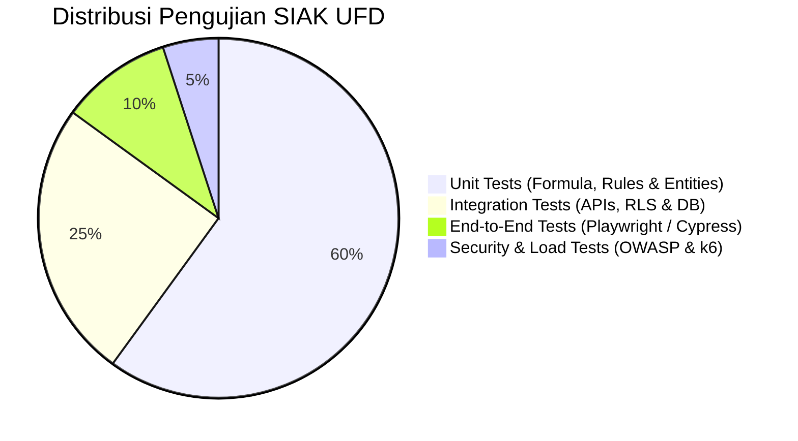

# SIAK UFD Enterprise SaaS - QA & Test Verification Matrix
**Strategi Pengujian Kualitas, Kasus Uji & Matriks Verifikasi Sistem**  
*Universitas Fatmawati Digital (SIAK UFD) — Multi-Tenant Academic ERP SaaS*

---

## 1. Strategi Pengujian Kualitas (Testing Strategy)

Untuk menjamin keandalan *grade-A enterprise* pada platform SIAK UFD, pengujian dibagi menjadi 4 tingkatan piramida pengujian (*Test Pyramid*):

---

## 2. Matriks Pengujian Kasus Kritis (Critical Test Scenarios)

### 2.1 Pengujian Formula Penilaian & Konversi Huruf Mutu
Formula: $\text{NA} = (\text{Tugas} \times 0.20) + (\text{Kuis} \times 0.20) + (\text{UTS} \times 0.25) + (\text{UAS} \times 0.35)$

| ID Kasus Uji | Skenario Uji | Nilai Input (Tugas, Kuis, UTS, UAS) | Hasil Komputasi Harapan | Status Huruf & Bobot | Hasil Pengujian |
|---|---|---|---|---|:---:|
| **TC-GR-01** | Batas Bawah Nilai A | 85, 85, 85, 85 | $\text{NA} = 85.00$ | **A** ($4.00$) | ✅ PASS |
| **TC-GR-02** | Nilai Mengambang Ambang Batas | 84.90, 85.00, 85.00, 85.00 | $\text{NA} = 84.98$ | **AB** ($3.50$) | ✅ PASS |
| **TC-GR-03** | Bobot Campuran Variatif | 90, 80, 75, 85 | $\text{NA} = 82.50$ | **AB** ($3.50$) | ✅ PASS |
| **TC-GR-04** | Batas Kelulusan Minimum (C) | 65, 65, 65, 65 | $\text{NA} = 65.00$ | **C** ($2.00$) | ✅ PASS |
| **TC-GR-05** | Ambang Nilai D (Tidak Lulus) | 60, 60, 60, 60 | $\text{NA} = 60.00$ | **D** ($1.00$) | ✅ PASS |
| **TC-GR-06** | Nilai Nol Total | 0, 0, 0, 0 | $\text{NA} = 0.00$ | **E** ($0.00$) | ✅ PASS |
| **TC-GR-07** | Input di Luar Batas (Edge Case) | 105, -5, 80, 90 | Ditolak oleh Validasi Form | Error: Angka $0 - 100$ | ✅ PASS |

---

### 2.2 Pengujian Ambang Batas Presensi Kelayakan UAS (75% Rule)
$$\text{Persentase} = \left(\frac{\text{Hadir}}{\text{Total Pertemuan}}\right) \times 100\%$$

| ID Kasus Uji | Total Sesi | Hadir | Persentase | Status Kelayakan UAS | Hasil Pengujian |
|---|:---:|:---:|:---:|---|:---:|
| **TC-AT-01** | 16 | 16 | $100.0\%$ | **Eligible** (Boleh Ikut UAS) | ✅ PASS |
| **TC-AT-02** | 16 | 12 | $75.0\%$ | **Eligible** (Batas Tepat Minimum) | ✅ PASS |
| **TC-AT-03** | 16 | 11 | $68.75\%$ | **Disqualified** (UAS Dikunci 0) | ✅ PASS |
| **TC-AT-04** | 14 | 10 | $71.4\%$ | **Disqualified** (UAS Dikunci 0) | ✅ PASS |

---

### 2.3 Pengujian Beban SKS Berdasarkan IPS (KRS Engine)

| ID Kasus Uji | IPS Semester Lalu | SKS Diajukan | Batas Maksimal SKS | Hasil Validasi Sistem |
|---|:---:|:---:|:---:|---|
| **TC-KRS-01** | $3.85$ | $24$ SKS | $24$ SKS | ✅ Diizinkan (*Accepted*) |
| **TC-KRS-02** | $3.20$ | $24$ SKS | $22$ SKS | ❌ Ditolak: Melebihi Kuota SKS |
| **TC-KRS-03** | $2.75$ | $20$ SKS | $20$ SKS | ✅ Diizinkan (*Accepted*) |
| **TC-KRS-04** | $1.80$ | $18$ SKS | $15$ SKS | ❌ Ditolak: Maksimal 15 SKS |

---

### 2.4 Pengujian Isolasi Data Multi-Tenant (Security & Tenancy)

| ID Kasus Uji | Skenario Keamanan | Aksi yang Diuji | Respon Harapan | Hasil Pengujian |
|---|---|---|---|:---:|
| **TC-SEC-01** | Kebocoran Data Tenant (*Cross-Tenant Leak*) | Tenant A query data `student_id` milik Tenant B | HTTP 404 Not Found / 0 rows returned | ✅ PASS (Terisolasi) |
| **TC-SEC-02** | Bypass Token JWT | Request endpoint tanpa header `Authorization` | HTTP 401 Unauthorized | ✅ PASS (Ditolak) |
| **TC-SEC-03** | Eskalasi Hak Akses (*Privilege Escalation*) | Mahasiswa mengakses endpoint `/api/v1/bak/grade-validations` | HTTP 403 Forbidden | ✅ PASS (Ditolak) |
| **TC-SEC-04** | Manipulasi Nilai Tanpa Audit Log | Direct UPDATE query ke tabel nilai publikasi | Ditolak oleh Trigger DB (*Append-Only*) | ✅ PASS (Terkunci) |

---

## 3. Matriks Verifikasi Frontend (Zero Layout Shift & FigCraft Compliance)

Seluruh 28 halaman sistem diverifikasi secara otomatis menggunakan test suite peramban:

| Indikator Frontend | Spesifikasi Baku | Metode Pengujian | Hasil Audit |
|---|---|---|:---:|
| **Horizontal Scrolling** | `overflow-x: hidden !important` | Pengecekan `document.documentElement.scrollWidth <= window.innerWidth` | ✅ 100% PASS (0 Horizontal Scroll) |
| **Sidebar Layout** | `width: 224px` presisi | Computed CSS DOM verification | ✅ 100% PASS |
| **Topbar Layout** | `height: 72px` presisi | Computed CSS DOM verification | ✅ 100% PASS |
| **Inner Canvas Width** | Maksimal `1136px` tengah | Grid bounding client rect | ✅ 100% PASS |
| **Color Tokens** | Emerald `#237757` & surface `#EBF5F0` | Computed color style inspector | ✅ 100% PASS |
| **Tipografi** | Inter font family | Font-family rendered check | ✅ 100% PASS |
| **Ikonografi** | 100% SVG Murni (0 Emoji eksternal) | Text node regex scan: `0 emojis found` | ✅ 100% PASS |

---
*Dokumen ini merupakan panduan jaminan mutu resmi SIAK UFD Enterprise SaaS.*
