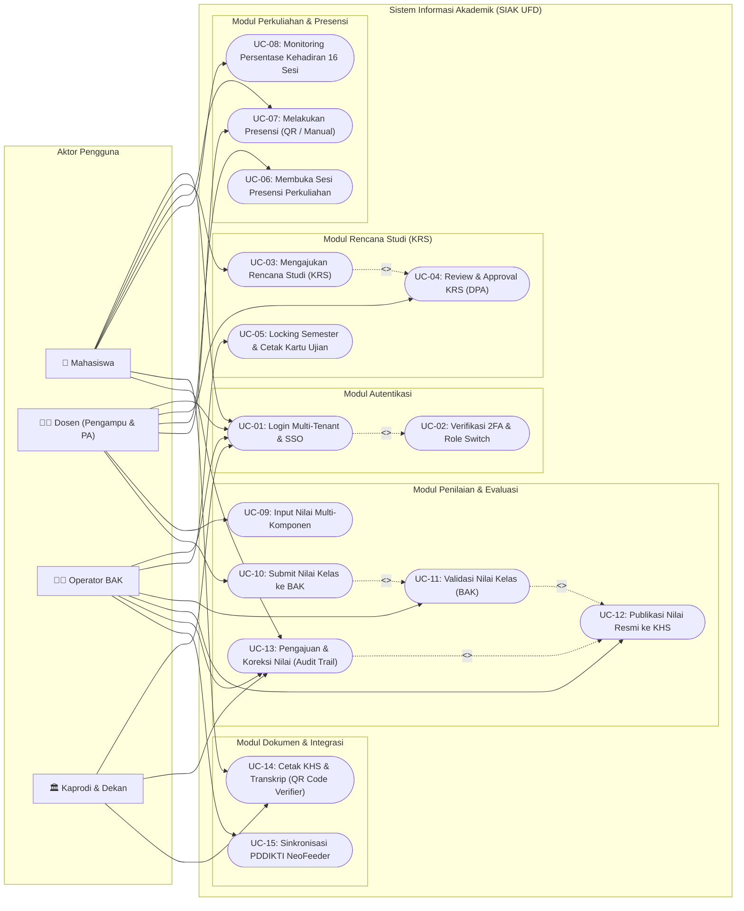
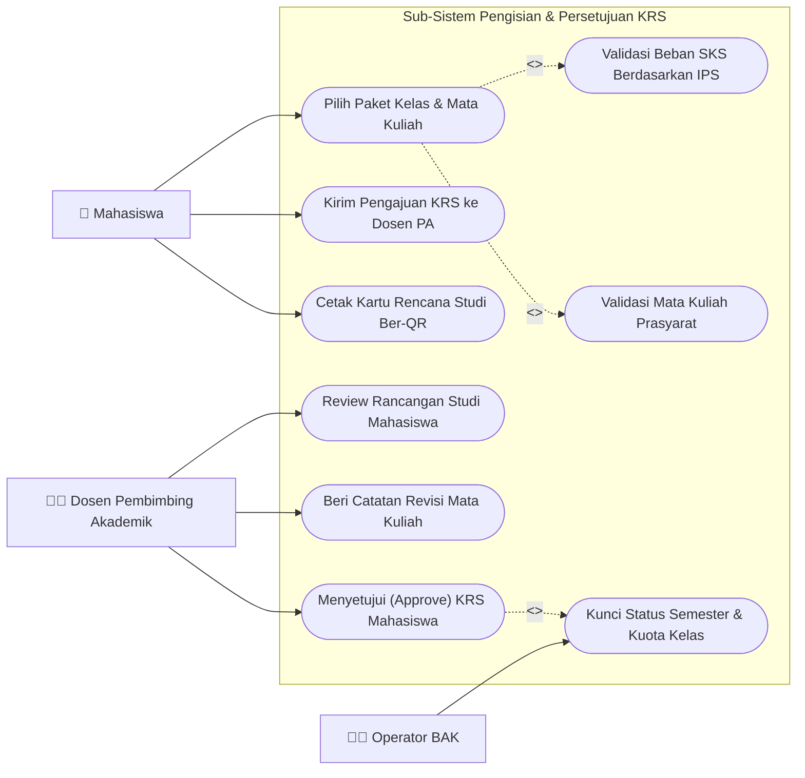
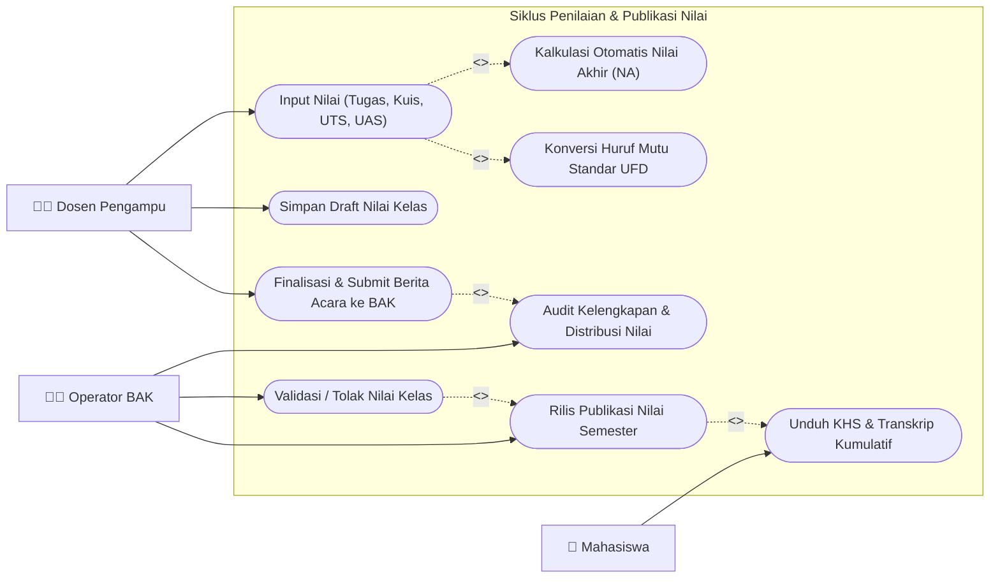

# SIAK UFD Enterprise SaaS - Use Case Diagrams & Specifications
**Diagram Use Case & Kamus Spesifikasi Kebutuhan Fungsional**  
*Universitas Fatmawati Digital (SIAK UFD) — Multi-Tenant Academic ERP SaaS*

---

## 1. Ikhtisar Diagram Use Case Global (Global System Boundary)

Platform SIAK UFD memiliki 4 aktor utama yang berinteraksi di dalam batas sistem (*System Boundary*):
1. **Mahasiswa**: Mengelola rencana studi, mengikuti presensi, melihat nilai, dan mencetak dokumen akademik.
2. **Dosen Pengampu & PA**: Mengelola perkuliahan, mengisi presensi, membimbing KRS, dan memasukkan nilai multi-komponen.
3. **Operator BAK**: Mengelola master data akademik, memvalidasi nilai dosen, mempublikasikan KHS, dan mengeksekusi koreksi nilai.
4. **Kaprodi / Dekan**: Mengawasi mutu akademik, menyetujui pembukaan kurikulum, dan memberikan otorisasi banding perbaikan nilai.

---

## 2. Diagram Use Case per Sub-Sistem

### 2.1 Sub-Sistem Rencana Studi (KRS Lifecycle)

### 2.2 Sub-Sistem Penilaian, Validasi BAK & Publikasi KHS

---

## 3. Kamus Spesifikasi Use Case (Use Case Specifications)

Berikut adalah rincian skenario operasional untuk use case kritis sistem:

### UC-01: Autentikasi Pengguna & Resolusi Tenant SSO
- **Aktor Utama**: Mahasiswa, Dosen, Operator BAK, Kaprodi/Dekan.
- **Tujuan**: Memverifikasi identitas pengguna, mengisolasi data ke tenant universitas yang tepat, dan menghasilkan token otentikasi JWT.
- **Pra-Kondisi (*Preconditions*)**:
  1. Pengguna memiliki kredensial terdaftar (NIM / NIDN / NIP dan password).
  2. Tenant institusi berada dalam status aktif (*Subscription Active*).
- **Pemicu (*Trigger*)**: Pengguna mengakses halaman login dan menekan tombol *Masuk Portal*.
- **Alur Utama (*Main Scenario*)**:
  1. Pengguna memasukkan identitas (NIM/NIDN), kata sandi, dan memilih role pada [pages/auth/login.html](file:///C:/Users/Lenovo/Downloads/LMS/pages/auth/login.html).
  2. Sistem memverifikasi kredensial terhadap database terisolasi tenant (`tenant_id`).
  3. Sistem memvalidasi status keaktifan akun.
  4. Sistem menghasilkan sepasang token JWT: `Access Token` (umur 15 menit) dan `Refresh Token` (umur 7 hari dalam HttpOnly cookie).
  5. Sistem mengarahkan pengguna ke dashboard sesuai role:
     - Mahasiswa $\to$ `pages/mahasiswa/dashboard/index.html`
     - Dosen $\to$ `pages/dosen/dashboard/index.html`
     - Operator BAK $\to$ `pages/akademik/dashboard/index.html`
- **Alur Alternatif (*Alternative Scenario*)**:
  - *3a. Akun Dosen memiliki peran ganda (Dosen Pengampu sekaligus DPA atau Kaprodi)*: Sistem menyajikan modal pemilihan peran aktif (*Role Switcher*).
- **Alur Pengecualian (*Exception Scenario*)**:
  - *2a. Password salah $\ge 5$ kali berturut-turut*: Sistem mengunci akun selama 15 menit dan mencatat insiden keamanan ke log audit.
  - *2b. Masa langganan tenant universitas kedaluwarsa*: Sistem menampilkan halaman penangguhan akses tenant (*Tenant Suspended*).
- **Pasca-Kondisi (*Postconditions*)**: Sesi pengguna tersimpan di Redis cache dan seluruh request berikutnya menyertakan Bearer Token valid.

---

### UC-03: Pengajuan Rencana Studi (KRS)
- **Aktor Utama**: Mahasiswa.
- **Aktor Sekunder**: Academic Rule Engine.
- **Pra-Kondisi**:
  1. Kalender akademik periode KRS sedang dibuka oleh Operator BAK.
  2. Mahasiswa berstatus registrasi aktif pada semester berjalan (bebas tunggakan keuangan).
- **Alur Utama**:
  1. Mahasiswa membuka modul [pages/mahasiswa/krs/index.html](file:///C:/Users/Lenovo/Downloads/LMS/pages/mahasiswa/krs/index.html).
  2. Sistem mengambil IPS semester lalu dan menetapkan kuota maksimal SKS (misal: $\text{IPS } 3.75 \to 24 \text{ SKS}$).
  3. Mahasiswa memilih kelas mata kuliah dari daftar kurikulum program studi.
  4. Sistem memeriksa prasyarat mata kuliah dan bentrokan jadwal secara *real-time*.
  5. Mahasiswa menekan tombol **Ajukan KRS ke Dosen PA**.
  6. Status KRS berubah menjadi `SUBMITTED` dan notifikasi pengajuan dikirimkan ke dashboard Dosen PA.
- **Alur Alternatif**:
  - *3a. Mahasiswa membatalkan mata kuliah yang sudah dipilih sebelum melakukan submit*: Sistem mengembalikan kuota kursi kelas.
- **Alur Pengecualian**:
  - *4a. Total SKS melebihi batas IPS*: Sistem menampilkan pesan error dan menonaktifkan tombol submit.
  - *4b. Kuota kelas penuh*: Sistem menyarankan kelas paralel alternatif (misal: dari Kelas TI-3A ke Kelas TI-3B).
- **Pasca-Kondisi**: KRS tersimpan dengan status `SUBMITTED` dan terkunci dari perubahan mahasiswa sampai direview oleh Dosen PA.

---

### UC-09: Input Nilai Multi-Komponen oleh Dosen
- **Aktor Utama**: Dosen Pengampu.
- **Pra-Kondisi**:
  1. Dosen ditugaskan sebagai pengampu kelas mata kuliah bersangkutan.
  2. Periode input nilai semester aktif telah dibuka oleh BAK.
- **Alur Utama**:
  1. Dosen membuka menu [pages/dosen/input-nilai/index.html](file:///C:/Users/Lenovo/Downloads/LMS/pages/dosen/input-nilai/index.html).
  2. Dosen memilih kelas dan mata kuliah yang diampu.
  3. Sistem memuat daftar mahasiswa yang terdaftar sah di kelas tersebut.
  4. Dosen memasukkan nilai numerik ($0 - 100$) untuk: Tugas ($20\%$), Kuis ($20\%$), UTS ($25\%$), dan UAS ($35\%$).
  5. Sistem secara otomatis menghitung Nilai Akhir (NA) dan menentukan Huruf Mutu (A, AB, B, BC, C, D, E).
  6. Dosen menekan **Simpan Draft**.
  7. Sistem menyimpan nilai dengan status `DRAFT`.
- **Alur Alternatif**:
  - *4a. Dosen mengimpor berkas Excel*: Sistem memvalidasi format kolom dan mencocokkan NIM secara otomatis.
- **Alur Pengecualian**:
  - *4b. Nilai angka di luar rentang $0 - 100$*: Input disorot merah dan tidak dapat disimpan.
- **Pasca-Kondisi**: Data nilai tersimpan di basis data dalam status sementara (*Draft*), siap difinalisasi.

---

### UC-11: Validasi Nilai Kelas oleh Operator BAK
- **Aktor Utama**: Operator BAK.
- **Pra-Kondisi**: Nilai kelas telah disubmit oleh Dosen Pengampu dengan status `SUBMITTED`.
- **Alur Utama**:
  1. Operator BAK membuka antrean validasi pada [pages/akademik/validasi-nilai/index.html](file:///C:/Users/Lenovo/Downloads/LMS/pages/akademik/validasi-nilai/index.html).
  2. Sistem menampilkan daftar kelas yang menunggu verifikasi beserta metrik statistik (rata-rata nilai, sebaran kelulusan).
  3. Operator BAK memeriksa kelengkapan:
     - Seluruh mahasiswa telah memiliki nilai (0 null).
     - Mahasiswa dengan kehadiran $<75\%$ terverifikasi tidak berhak nilai UAS.
  4. Operator BAK menekan tombol **Setujui & Validasi Kelas**.
  5. Status nilai kelas diperbarui menjadi `VALIDATED`.
- **Alur Alternatif (Penolakan Nilai)**:
  - *3a. Terdapat ketidakwajaran data (misal: 100% mahasiswa diberi nilai E tanpa penjelasan)*:
    - Operator menekan tombol **Tolak / Minta Revisi**.
    - Operator memasukkan catatan berita acara penolakan.
    - Sistem mengubah status kembali ke `REJECTED` dan membuka kembali akses edit bagi Dosen Pengampu.
- **Pasca-Kondisi**: Nilai berstatus `VALIDATED` dan siap dipublikasikan massal pada modul publikasi nilai.

---

### UC-12: Publikasi Nilai Resmi ke KHS
- **Aktor Utama**: Operator BAK.
- **Pra-Kondisi**: Terdapat kelas-kelas yang telah berstatus `VALIDATED`.
- **Alur Utama**:
  1. Operator BAK membuka modul [pages/akademik/publikasi-nilai/index.html](file:///C:/Users/Lenovo/Downloads/LMS/pages/akademik/publikasi-nilai/index.html).
  2. Operator memfilter berdasarkan Fakultas, Program Studi, dan Semester Aktif.
  3. Sistem menampilkan ringkasan kelas siap rilis.
  4. Operator memilih kelas atau memilih **Publikasi Seluruh Program Studi**.
  5. Sistem menampilkan modal konfirmasi risiko permanen.
  6. Operator menekan **Konfirmasi Publikasi Resmi**.
  7. Sistem mengunci nilai secara permanen (`PUBLISHED`), menghitung IPS & IPK mahasiswa secara agregat, dan menerbitkan KHS ke modul mahasiswa [pages/mahasiswa/khs/index.html](file:///C:/Users/Lenovo/Downloads/LMS/pages/mahasiswa/khs/index.html).
- **Pasca-Kondisi**: Nilai resmi tampil di portal mahasiswa dan perubahan nilai selanjutnya wajib melalui mekanisme banding (*Koreksi Nilai*).

---

### UC-13: Pengajuan & Koreksi Nilai Pasca Publikasi (Audit Trail)
- **Aktor Utama**: Mahasiswa, Dosen, Kaprodi, Dekan, Operator BAK.
- **Pra-Kondisi**: Nilai mata kuliah telah berstatus `PUBLISHED`.
- **Alur Utama**:
  1. Mahasiswa atau Dosen mengajukan permohonan banding koreksi nilai di [pages/akademik/perbaikan-nilai/index.html](file:///C:/Users/Lenovo/Downloads/LMS/pages/akademik/perbaikan-nilai/index.html).
  2. Pemohon melampirkan berkas bukti fisik (lembar jawaban ujian, rekap presensi, berita acara).
  3. Kaprodi meninjau validitas berkas dan menyetujui permohonan.
  4. Dekan Fakultas memberikan otorisasi final via tanda tangan digital.
  5. Operator BAK mengeksekusi override perubahan nilai di sistem.
  6. Sistem mencatat transaksi secara mendalam pada tabel `grade_audit_logs` (NIM, Nilai Lama, Nilai Baru, Alasan, Bukti URL, Timestamp, IP Address, Eksekutor).
  7. Sistem memicu re-kalkulasi IPS/IPK mahasiswa dan mencetak watermark revisi pada KHS.
- **Pasca-Kondisi**: Log audit terkunci secara permanen (*Append-Only*) dan KHS mahasiswa terbarui otomatis.

---

### UC-14: Unduh KHS & Transkrip dengan QR Verifier
- **Aktor Utama**: Mahasiswa, Operator BAK.
- **Pra-Kondisi**: Mahasiswa memiliki riwayat akademik yang telah dipublikasikan.
- **Alur Utama**:
  1. Pengguna membuka [pages/mahasiswa/khs/index.html](file:///C:/Users/Lenovo/Downloads/LMS/pages/mahasiswa/khs/index.html) atau [pages/mahasiswa/transkrip/index.html](file:///C:/Users/Lenovo/Downloads/LMS/pages/mahasiswa/transkrip/index.html).
  2. Pengguna menekan tombol **Unduh PDF Resmi** atau **Cetak KHS**.
  3. Sistem mengompilasi lembar dokumen akademik sesuai format standar institusi.
  4. Sistem menghasilkan hash digital (SHA-256) yang merepresentasikan integritas isi nilai.
  5. Sistem merender kode QR yang mengarah ke endpoint validasi publik `https://verify.ufd.ac.id/doc/{doc_hash}`.
  6. Berkas PDF terunduh atau jendela dialog cetak peramban terbuka.
- **Pasca-Kondisi**: Dokumen dapat diverifikasi keasliannya oleh pihak eksternal (perusahaan, institusi lain) cukup dengan memindai kode QR.

---
*Dokumen ini merupakan spesifikasi Use Case resmi SIAK UFD Enterprise SaaS yang menjadi acuan pengujian fungsional dan pengembangan antarmuka.*
