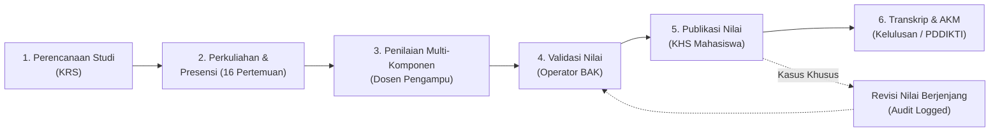
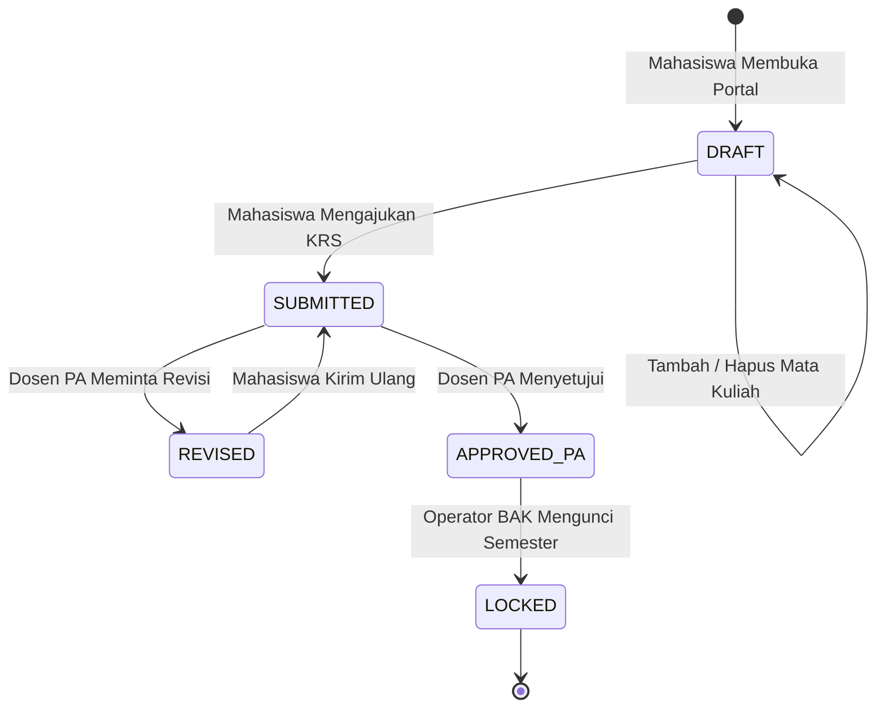
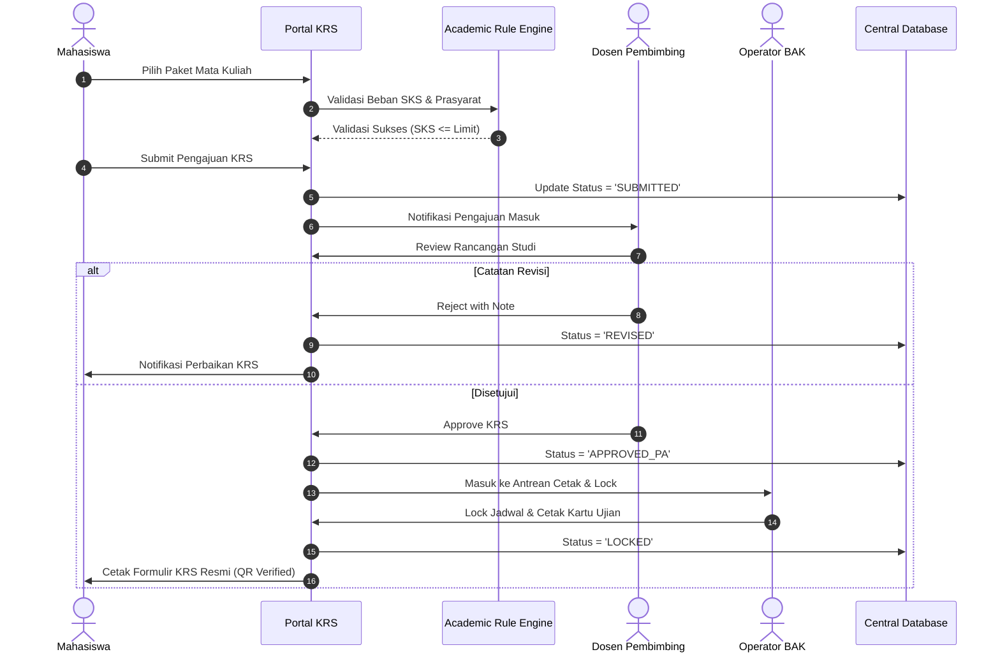
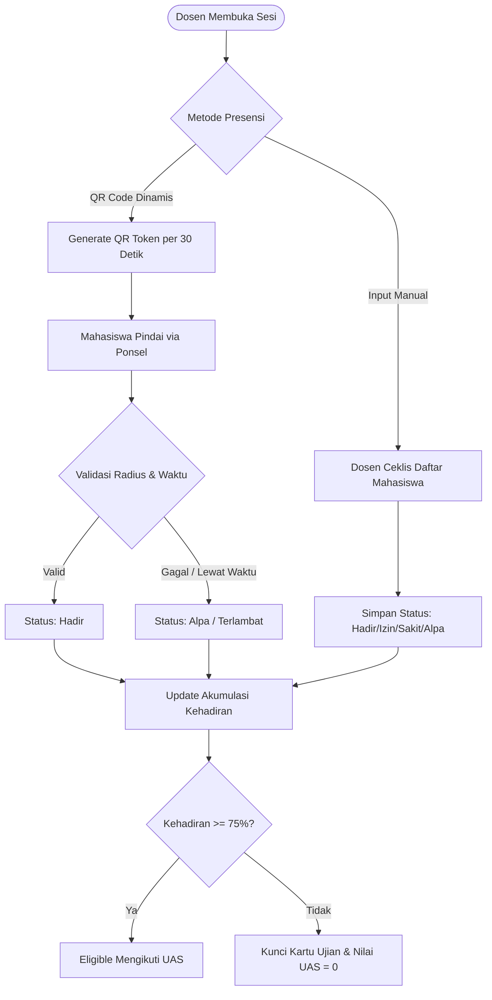
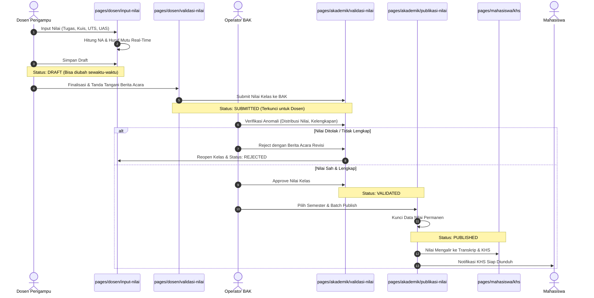
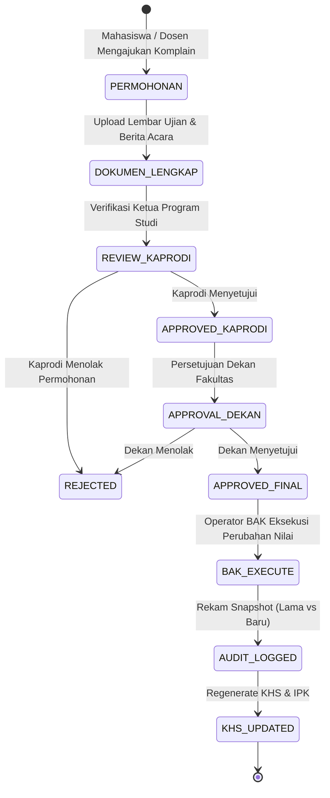
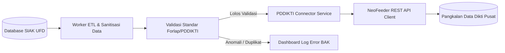

# SIAK UFD Enterprise SaaS - Business Workflows & State Machines
**Dokumen Alur Kerja Bisnis & Siklus Hidup Data Akademik**  
*Universitas Fatmawati Digital (SIAK UFD) — Multi-Tenant Academic ERP SaaS*

---

## 1. Ikhtisar Alur Kerja (Workflow Overview)

SIAK UFD dirancang menggunakan prinsip **Event-Driven Workflow** dan **State Machine Pattern** yang ketat untuk memastikan integritas data akademik tingkat tinggi. Setiap proses akademik memiliki tahapan (*state*), hak akses (*role permissions*), aturan transisi (*transition rules*), dan jejak audit (*audit trails*) yang tidak dapat dimanipulasi (*immutable*).



---

## 2. Workflow 1: Siklus Perencanaan Studi (KRS / FRS Lifecycle)

### 2.1 Deskripsi Bisnis
Proses pemilihan mata kuliah oleh mahasiswa pada setiap awal semester berdasarkan IPS semester sebelumnya, verifikasi dan konsultasi dengan Dosen Pembimbing Akademik (DPA), serta penetapan kuota kelas oleh Biro Administrasi Akademik dan Kemahasiswaan (BAK).

### 2.2 Aturan Bisnis (Business Rules)
1. **Batas Beban SKS**: Dihitung otomatis dari IPS semester sebelumnya:
   - $\text{IPS} \ge 3.50 \implies \text{Maksimal } 24 \text{ SKS}$
   - $3.00 \le \text{IPS} < 3.50 \implies \text{Maksimal } 22 \text{ SKS}$
   - $2.50 \le \text{IPS} < 3.00 \implies \text{Maksimal } 20 \text{ SKS}$
   - $2.00 \le \text{IPS} < 2.50 \implies \text{Maksimal } 18 \text{ SKS}$
   - $\text{IPS} < 2.00 \implies \text{Maksimal } 15 \text{ SKS}$
2. **Prasyarat Mata Kuliah**: Sistem memvalidasi apakah mata kuliah prasyarat telah lulus minimal dengan nilai C ($2.00$).
3. **Bentrokan Jadwal**: Sistem memblokir pemilihan 2 mata kuliah yang memiliki irisan hari dan jam yang sama.
4. **Kapasitas Kelas**: Kuota kelas dikunci saat `terisi == kapasitas`.

### 2.3 State Machine KRS


### 2.4 Sequence Diagram Persetujuan KRS


---

## 3. Workflow 2: Siklus Perkuliahan & Presensi 16 Pertemuan

### 3.1 Deskripsi Bisnis
Pencatatan realisasi perkuliahan semester yang terdiri atas 14 sesi tatap muka + 1 sesi UTS + 1 sesi UAS. Kehadiran mahasiswa menjadi prasyarat mutlak keikutsertaan ujian akhir.

### 3.2 Aturan Kelayakan UAS
$$\text{Persentase Kehadiran} = \left( \frac{\text{Jumlah Pertemuan Hadir}}{\text{Total Pertemuan Berjalan}} \right) \times 100\%$$
- **Syarat Minimal Mengikuti UAS**: $\text{Persentase Kehadiran} \ge 75\%$.
- Mahasiswa dengan kehadiran $< 75\%$ otomatis berstatus **DISQUALIFIED_EXAM** pada mata kuliah tersebut, dan nilai UAS dikunci menjadi 0.

### 3.3 Flowchart Pelaksanaan Presensi


---

## 4. Workflow 3: Formula Penilaian Multi-Komponen Dinamis

### 4.1 Bobot Baku Penilaian Standar
Sesuai standar akademik UFD, formula pembobotan nilai akhir dikomputasi secara presisi:
$$\text{Nilai Akhir (NA)} = (Tugas \times 0.20) + (Kuis \times 0.20) + (UTS \times 0.25) + (UAS \times 0.35)$$

### 4.2 Tabel Konversi Huruf Mutu & Angka Mutu
| Rentang Nilai Angka | Huruf Mutu | Angka Mutu (Bobot) | Kategori Kelulusan | Status PDDIKTI |
|---|:---:|:---:|---|---|
| $85.00 - 100.00$ | **A** | $4.00$ | Istimewa | Lulus |
| $80.00 - 84.99$ | **AB** | $3.50$ | Sangat Baik | Lulus |
| $75.00 - 79.99$ | **B** | $3.00$ | Baik | Lulus |
| $70.00 - 74.99$ | **BC** | $2.50$ | Cukup Baik | Lulus |
| $65.00 - 69.99$ | **C** | $2.00$ | Cukup (Batas Minimal Lulus) | Lulus |
| $55.00 - 64.99$ | **D** | $1.00$ | Kurang (Wajib Mengulang) | Belum Lulus |
| $0.00 - 54.99$ | **E** | $0.00$ | Gagal (Wajib Mengulang) | Tidak Lulus |

---

## 5. Workflow 4: Pipeline Pengajuan Nilai, Validasi BAK & Publikasi KHS

### 5.1 Deskripsi Pipeline
Alur perpindahan nilai dari ruang kerja dosen hingga tersaji resmi di Kartu Hasil Studi (KHS) mahasiswa dan siap disinkronisasi ke PDDIKTI.



### 5.2 Aturan Validasi Operator BAK (`pages/akademik/validasi-nilai`)
Sebelum nilai disetujui, sistem menjalankan checklist validasi otomatis:
1. **Zero Null Rule**: Seluruh mahasiswa terdaftar wajib memiliki nilai pada setiap komponen.
2. **Attendance Lock Check**: Mahasiswa dengan presensi $<75\%$ tidak boleh memiliki nilai UAS $>0$.
3. **Bell Curve / Outlier Warning**: Sistem memunculkan alert jika $100\%$ mahasiswa mendapatkan nilai E atau seluruh mahasiswa mendapatkan nilai A tanpa variasi wajar.

---

## 6. Workflow 5: Koreksi & Perbaikan Nilai Pasca Publikasi (Audit Trail)

### 6.1 Deskripsi Bisnis
Setelah nilai berstatus `PUBLISHED`, nilai **tidak dapat diubah langsung** oleh dosen maupun operator biasa. Perubahan nilai harus melalui prosedur banding resmi yang diawasi oleh Kaprodi dan Dekan.

### 6.2 Alur Persetujuan Berjenjang (Hierarchical Approval)


### 6.3 Struktur Rekaman Jejak Audit (`grade_audit_logs`)
Setiap eksekusi perbaikan nilai wajib mencatat skema berikut:
```json
{
  "audit_id": "aud-987214-2026",
  "tenant_id": "ten-ufd-prod",
  "student_nim": "2301010042",
  "course_code": "IF3102",
  "semester_id": "20251",
  "previous_score": { "tugas": 70, "kuis": 65, "uts": 60, "uas": 55, "final_letter": "C", "point": 2.0 },
  "updated_score": { "tugas": 70, "kuis": 85, "uts": 80, "uas": 85, "final_letter": "A", "point": 4.0 },
  "reason": "Koreksi salah input lembar jawaban UAS susulan yang tertukar di berkas fisik",
  "supporting_doc_url": "s3://ufd-docs/audit/2026/BA-koreksi-2301010042.pdf",
  "approved_by_dekan": "NIDN-0412087501",
  "executed_by_bak": "OPR-BAK-003",
  "client_ip": "10.20.1.15",
  "timestamp": "2026-11-18T08:15:30Z"
}
```

---

## 7. Workflow 6: Penerbitan Dokumen Resmi (KHS, Transkrip & Ijazah)

### 7.1 Algoritma Kalkulasi IPK Kumulatif (Transkrip)
Jika mahasiswa mengambil mata kuliah yang sama lebih dari satu kali (mengulang), sistem menerapkan aturan:
$$\text{Aturan Pengulangan} = \max(\text{Nilai Terbaik})$$
Contoh: Mahasiswa mengambil *Algoritma Pemrograman* di Semester 1 mendapat **D (1.0)**, lalu mengulang di Semester 3 mendapat **B (3.0)**. Dalam transkrip akhir, yang dihitung dalam SKS lulus dan pembagi IPK adalah **B (3.0)**.

$$\text{IPK} = \frac{\sum_{i=1}^{N} (\text{SKS}_i \times \text{Bobot Nilai Terbaik}_i)}{\sum_{i=1}^{N} \text{SKS}_i}$$

### 7.2 Verifikasi Keaslian Dokumen Tanpa Login (QR Digital Signature)
Setiap dokumen KHS dan Transkrip yang diunduh menyematkan QR code dinamis yang memuat cryptographic hash:
```
URL: https://verify.ufd.ac.id/doc/{document_hash}
Payload Signed:
- Student Identity: NIM + Full Name
- Program Studi & Fakultas
- Tanggal Terbit Dokumen & Pejabat Penandatangan
- Total SKS Lulus & IPK Resmi
- SHA-256 Checksum dari Seluruh Mata Kuliah
```
Pihak ketiga (perusahaan, kementerian, universitas luar negeri) dapat memindai QR code ini untuk melihat validitas berkas tanpa harus memiliki kredensial akun SIAK.

---

## 8. Workflow 7: Siklus Sinkronisasi PDDIKTI NeoFeeder

### 8.1 Arsitektur Sinkronisasi
SIAK UFD dilengkapi dengan gateway otomatis berbasis REST/Webservice ke database lokal NeoFeeder Kemendikbudristek.



### 8.2 Tabel Siklus Pelaporan per Semester
1. **Awal Semester**:
   - Sinkronisasi Kurikulum & Mata Kuliah Aktif.
   - Sinkronisasi Daftar Dosen Penugasan & Mahasiswa Baru.
   - Sinkronisasi KRS Kelas Mahasiswa.
2. **Pertengahan Semester**:
   - Sinkronisasi Status Mahasiswa (Aktif, Cuti, Non-Aktif).
3. **Akhir Semester**:
   - Sinkronisasi Presensi Perkuliahan (Realisasi Dosen).
   - Sinkronisasi Nilai Akhir (KHS) Mahasiswa.
   - Sinkronisasi Aktivitas Kuliah Mahasiswa (AKM: IPS, IPK, SKS Semester, SKS Total).
   - Sinkronisasi Data Mahasiswa Lulus / Drop Out (Yudisium).

---

## 9. Ringkasan Hak Akses & Matriks Persetujuan (Approval Matrix)

| Aksi Sistem | Mahasiswa | Dosen Pengampu | Dosen PA | Operator BAK | Kaprodi / Dekan |
|---|:---:|:---:|:---:|:---:|:---:|
| Buat Rancangan KRS | **Owner** | Read | Read | Read | Read |
| Setujui / Revisi KRS | - | - | **Approve** | Admin Lock | Read |
| Buka Presensi Kelas | - | **Owner** | - | Admin Override | Read |
| Isi Presensi Mahasiswa | **Scan QR** | **Checklist** | - | Admin Override | - |
| Input Nilai Komponen | - | **Owner** | - | - | - |
| Submit Nilai ke Validasi | - | **Submit** | - | - | - |
| Validasi Nilai Kelas | - | - | - | **Approve/Reject** | Read |
| Publikasi Nilai Resmi ke KHS | - | - | - | **Publish** | Read |
| Pengajuan Perbaikan Nilai | Permohonan | Permohonan | - | Verifikasi Berkas | **Approve** |
| Eksekusi Perbaikan Nilai | - | - | - | **Execute Audit** | - |
| Cetak KHS & Transkrip | Download | Read | Read | Cetak Massal | Read |
| Sinkronisasi NeoFeeder | - | - | - | **Operator Sync** | Read Laporan |

---
*Dokumen ini merupakan spesifikasi alur resmi SIAK UFD Enterprise SaaS. Segala bentuk implementasi kode, API endpoint, dan logika antarmuka wajib merujuk secara ketat pada aturan alur ini.*
